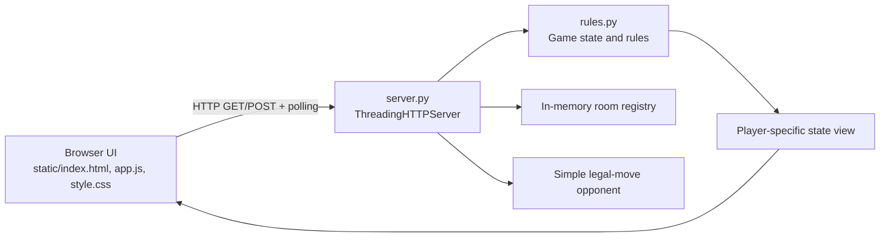
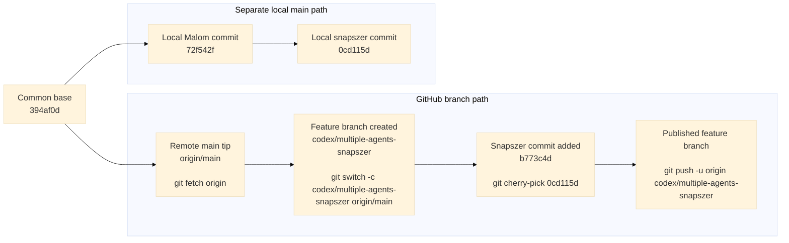

# Húzós snapszer — Architecture and User Manual

## 1. What this app is

This is a small, two-player browser prototype for húzós snapszer. It supports three play modes:

- **Játék a gép ellen** — you play against a simple server-side computer opponent.
- **Két játékos, egy eszköz** — two people take turns on one browser/device.
- **Online szoba** — one player creates a room and another joins with its six-character code.

The browser is the client. A Python process hosts the game and serves both the interface and the game API. The game uses Hungarian labels throughout.

## 2. Architecture at a glance



### Components

| File | Responsibility |
| --- | --- |
| `rules.py` | Creates the 20-card deck; deals cards; computes legal plays; resolves tricks; draws cards; tracks points, marriages, talon closure, and the winner. It does not depend on the browser or HTTP server. |
| `server.py` | Serves static files, creates and joins rooms, authenticates each seat, validates actions through the game state, runs the AI, and returns a player-specific view. |
| `static/index.html` | Defines the Hungarian lobby, table, score panel, and game controls. |
| `static/style.css` | Provides the responsive card-table appearance and responsive layout. Card faces crop the local Hungarian Tell sheet as a sprite. |
| `static/app.js` | Calls the API, polls for updates, and renders only the current browser player's cards and legal options. It maps each card to its image-sheet row and column, and draws inline SVG suit marks: heart for Piros, bell for Tök, leaf for Zöld, and acorn for Makk. It does not decide game rules. |
| `static/original-hungarian-tell-set.jpg` | The attributed Tell-card sprite sheet used for card faces. See [`ASSETS.md`](./ASSETS.md) for credit and license. |
| `test_rules.py` | Focused rule checks for the deck, deal, trick resolution, draw order, forced play, marriages, hidden hands, and talon closure. |

### Room and request flow

1. The first player creates a room with `POST /api/rooms`, selecting AI, hot-seat, or online mode.
2. The server creates a shuffled game and returns a room code plus an unguessable seat token. In online mode, the second player submits the room code to `POST /api/rooms/{code}/join` and receives a different token.
3. The browser polls `GET /api/rooms/{code}?token=...` roughly once a second. Each response contains that seat's own hand and the IDs of its legal cards. The other player's hand and the deck order are never included in the response.
4. A play, exchange, or talon-cover action is submitted to `POST /api/rooms/{code}/act`. The server checks the token, turn, card, and action before changing game state.
5. In AI mode, the server plays the computer's turn immediately after the human's action.

Room state and seat tokens live in the server process's memory. Restarting the process removes all rooms. The browser stores its room code and token locally to make a page refresh reconnect to a still-running room.

## 3. Network and security boundaries

The server listens on all local interfaces at port 8000. This lets another device on the same local network reach the host computer using its LAN IP address. A six-character room code is only an invitation; the seat token is the credential used for API access.

This is a demonstration server, not an internet-ready service. It has no TLS, rate limits, accounts, durable storage, matchmaking, or deployment configuration. On a shared or public network, traffic and the Python process need suitable network protections. To play across the public internet, deploy it on a reachable host and put HTTPS in front of it.

Rooms are stored in memory, so restarting the server ends active deals. If the browser has a saved room that no longer exists, the app clears that session and returns to the start screen.

## 4. Rules and chosen variant

House rules vary. The prototype uses one documented two-player draw-pile variant, based on the [Schnapsen.at Hungarian rules](https://schnapsen.at/hu/szabalyok):

- The standard 32-card Hungarian deck has eight ranks in each suit. This two-player game removes VII, VIII, and IX, leaving 20 cards: Ász, Tízes, Király, Felső, and Alsó in Piros, Tök, Zöld, and Makk. Their point values are 11, 10, 4, 3, and 2; their trick order is Ász, Tízes, Király, Felső, Alsó.
- Card art uses the first five columns of the Hungarian Tell sheet: column 0 Ász, 1 Király, 2 Felső, 3 Alsó, and 4 Tízes. Rows 0–3 are Piros, Tök, Zöld, and Makk. Corner tags use the familiar Hungarian abbreviations Á, X, K, F, and A; **A means Alsó**, while **Á means Ász**. The card faces are cropped from the local sprite, with suit marks drawn by the app. Artwork attribution and license are in [`ASSETS.md`](./ASSETS.md).
- Each player receives five cards. Nine cards are face-down in the talon and one is exposed as trump. While the talon is open, any card can be played.
- The trick winner draws first; the other player draws second. The trick winner leads the next trick.
- When no draw cards remain, or the talon has been covered, a player follows suit. If possible, they play a higher card of that suit; if no such suit card is held, they play trump when available; otherwise they may play any card.
- A same-suit Király and Felső can be announced while leading. The pair is worth 20 points, or 40 in trump. The declaration counts once its owner has won a trick.
- The trump Alsó can exchange with the exposed trump while leading and while the talon is open.
- Covering the talon is allowed after the first trick while at least two face-down cards remain. No cards are drawn after covering. The covering player must reach 66 points or loses; the opponent can also win by reaching 66 first.
- The first player to reach 66 wins. If the open talon is exhausted and the deal ends before anyone gets 66, the last trick wins.
- Each trick's card points are awarded together to the player who wins that trick, including the card played by the opponent. At the end, the table displays the winner's name and the final score.

The computer opponent uses a small heuristic: it follows legal-move constraints, tends to take a trick with the lowest winning card, and prefers higher cards when leading. It is intentionally a simple opponent, not a strong strategic AI.

## 5. User manual

### Start the server

Install Python 3.10 or newer. Open PowerShell in the `Multiple Agents` directory and run:

```powershell
python server.py
```

Open <http://localhost:8000> in a modern browser. Leave the terminal running for the whole session.

### Play against the computer

1. Enter a name if you like.
2. Choose **Játék a gép ellen**.
3. Click one of your highlighted/legal cards to play it. The computer responds automatically. Its completed trick remains visible for five seconds before your next response is enabled.
4. When talon covering or trump exchange is legal, its action appears in the right-hand panel. A 20/40 marriage appears as two buttons directly above your hand when you lead with a same-suit Király + Felső. Choose the button for the card you want to play; that click both announces the marriage and plays that card. You do not select both cards.
5. The first player to 66 wins the deal.

### Play with two people on one device

1. Choose **Két játékos, egy eszköz**.
2. Play the current hand, then hand the device to the other player after each turn. The next player's hand appears automatically.

### Invite a player over the local network

1. On the host device, run the server and open it using `http://localhost:8000`.
2. Choose **Szoba létrehozása**. The table shows a room code.
3. Find the host computer's local IP address. On Windows, `ipconfig` shows it as the IPv4 address for the connected network adapter.
4. The other player opens `http://<host-LAN-IP>:8000` on the same Wi-Fi/network and enters the room code.
5. Play in turn. Both browsers poll the same server room for game updates.

If the other device cannot open the page, check that both devices are on the same network and that the host firewall allows Python to receive connections on port 8000.

### Start another deal or leave

Choose **Új játék** or **Kilépés a játékból** to return to the lobby. New rooms start with a fresh shuffle; the prototype does not maintain a match score across deals.

## 6. Run the focused checks

From this directory:

```powershell
python -m unittest -v
```

These checks cover core rules, not browser layout or remote-network deployment.

## Git workflow for this project

The repository root is the parent `malom` folder. These are the commands used to inspect, stage, commit, and publish this game. Staging only `Multiple Agents` keeps unrelated files in the repository out of the game commit:

```powershell
git status --short                         # Show changed, staged, and untracked files
git branch --show-current                  # Show the current local branch
git remote -v                              # Show fetch and push URLs (origin is GitHub)
git log -1 --oneline                       # Show the latest local commit
git add "Multiple Agents"                  # Stage only this game project
git diff --cached --stat                   # Review the staged change summary
git commit -m "Add Hungarian draw-pile Schnapsen demo"  # Save staged changes locally
git push -u origin codex/multiple-agents-snapszer # Publish this project branch and set its upstream
```

`git add` prepares a snapshot but does not commit it. `git commit` records that snapshot in local history. `git push` sends commits to the configured remote. Before committing, check that the staged diff contains only the snapszer project. The project's `.gitignore` excludes Python bytecode and `__pycache__` folders.

`git status --short` is a compact working-tree checklist: `M` means modified, `??` means untracked, and the first column can mark staged changes. `git branch --show-current` tells you which branch new commits will belong to. `git remote -v` shows where fetches and pushes go. `git log -1 --oneline` identifies the latest commit. `git add` stages selected paths; `git diff --cached --stat` lets you review the staged scope; `git commit` saves that snapshot locally. `git push -u origin <branch>` publishes the named branch and `-u` remembers its upstream, so future pushes can use just `git push`.

In this checkout, local `main` and GitHub's `origin/main` had diverged: local `main` included an unrelated Malom commit and uncommitted Malom files, while GitHub had newer commits of its own. Pushing local `main` would publish that unrelated commit too. So the snapszer work was published as its own feature branch. For a new project branch based on the latest remote main, use:

```powershell
git fetch origin
git switch -c codex/multiple-agents-snapszer origin/main
git cherry-pick <snapszer-commit>
git push -u origin codex/multiple-agents-snapszer
```

`git fetch origin` updates your local view of GitHub without changing files. `git switch -c` creates and switches to a branch starting at the latest remote main. `git cherry-pick` copies only the selected commit onto that branch. This avoids accidentally including commits from another local project. If there are uncommitted changes in files that the branch switch would replace, save them first with `git stash push --include-untracked`, then restore them with `git stash pop` after switching.

The larger diagram below labels each branch state with the command that moved the work there. Run the command shown on an arrow to move from the previous state to the next one. Commit IDs are the IDs from this session; when repeating the workflow for another feature, use that feature's commit ID.



The pushed branch starts from the latest GitHub `main` and contains the snapszer project by itself. The separate local `main` path shows why we did not push `main`: doing so would also have published the unrelated Malom commit. `git fetch` only updates the remote-tracking reference; `git switch -c` creates the feature branch; `git cherry-pick` copies the selected commit; `git push -u` publishes that branch.

## 7. How the agents worked together in this demo

The work was coordinated as a sequence of role-based handoffs, with the lead agent keeping the scope and integrating the result:

1. **Architecture agent:** inspected the existing Malom repository and proposed a separate `Multiple Agents/` folder, vanilla browser interface, standard-library Python room server, rules module, and an authoritative server boundary.
2. **QA/research agent:** independently checked the húzós snapszer rule details and produced an acceptance checklist before implementation. It highlighted rule variation points such as when the talon may be covered, how forced plays work, and when a marriage counts.
3. **Implementation agent:** built the isolated folder from that proposal and kept changes out of the pre-existing Malom files, which already contained unrelated local edits.
4. **QA feedback and repair:** the coordinator and QA agent inspected the implementation and sent specific findings back, including the card that must be played after a marriage announcement, no drawing after a covered talon, and the loss condition when the covering player fails to reach 66. The implementation was updated and focused checks were rerun.
5. **Lead coordinator:** aligned the roles' recommendations, resolved the rule assumptions, incorporated the user's card-art correction, and ran the final checks.

### Reusing this workflow

For future projects, give each role a bounded deliverable and state which files it may edit. A useful sequence is:

- Ask the architect to inspect the repository and propose component boundaries, APIs, and an implementation plan without editing code.
- Ask QA to independently research edge cases and write acceptance criteria before the main implementation begins.
- Give the coder the accepted plan, explicit constraints, and a file ownership boundary; ask it to report files changed and how it verified them.
- Have QA inspect the implementation and report concrete, reproducible findings. Send those findings to the coder for fixes, then have QA recheck them.
- Keep one coordinator responsible for shared decisions, preventing overlapping edits, and the final integrated review.

Example prompts:

> **Architecture:** “Inspect this repository and propose a small architecture for [feature]. Do not edit files. Identify interfaces, risks, and assumptions.”
>
> **QA:** “Independently derive acceptance criteria and edge cases for [feature]. Do not edit files. Report concrete checks the implementation must pass.”
>
> **Implementation:** “Implement the agreed plan in [folder/files] only. Preserve unrelated work. Report changed files and verification results.”
>
> **Review:** “Inspect the implementation against the agreed criteria. Do not edit files. Report reproducible bugs with file references and steps.”

Avoid assigning two agents to modify the same files at once. Give the reviewer the agreed specification, not just the code, so it can distinguish intended behavior from accidental behavior. The lead agent should relay findings explicitly rather than assuming every agent sees or infers another agent's notes.

In this Codex workflow, the subagents were coordinated under the parent task rather than appearing as three separate sidebar chats. The coordinator can query their roster and report each role's status here. OpenAI's multi-agent guide describes this coordinator-and-subagent model: independent agents work in parallel while the main agent combines the results ([Multi-agent guide](https://developers.openai.com/api/docs/guides/agents-api/multi-agent)).
