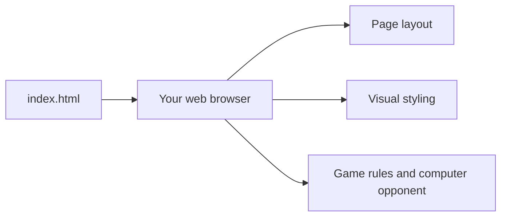
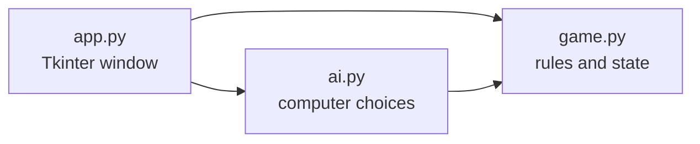

# Malom — Python edition

This is a learning-oriented Python recreation of the browser Malom game. It uses only the Python standard library and runs **on your computer** as a desktop window. It does not use a plugin, remote server, database, or web browser.

## First: how the original HTML game runs

The original [index.html](./index.html) is a complete, small web application:



When you open it, the browser reads the file from your disk and executes its embedded JavaScript locally. A web server is not needed. It is not a Codex plugin; Codex only helped create and edit the files.

It is small because HTML, CSS, and JavaScript are all embedded in one file. That is convenient for a compact demo, but separating responsibilities is easier to learn from and maintain. The Python version does that.

## Python project layout

```text
malom/
├── index.html              # Original browser version
├── README.md               # Browser version guide
├── README-python.md        # This guide
└── python_malom/
    ├── __init__.py         # Marks this as a Python package
    ├── game.py             # Board data and Malom rules (no interface code)
    ├── ai.py               # Small, readable computer-player strategy
    └── app.py              # Tkinter desktop window and drawing code
```



## Install Python

Python is not currently available from this project’s command line, so install a current Python 3 release from [python.org/downloads](https://www.python.org/downloads/windows/). During setup, select **Add Python to PATH**.

Open a new PowerShell window after installation and verify it:

```powershell
python --version
```

## Run the game

From this project folder, run:

```powershell
python -m python_malom.app
```

A desktop game window opens. Red is the human player; blue is the computer by default. Uncheck “Play against computer” for two local players.

No packages need to be installed: Tkinter, `dataclasses`, and `random` are included with standard Python.

## Read the code in this order

1. [game.py](./python_malom/game.py) — Start here. `Game` holds the board and implements legal moves, mills, captures, turns, wins, and draws.
2. [app.py](./python_malom/app.py) — See how Tkinter creates the window, draws the board on a `Canvas`, and passes clicks to the game rules.
3. [ai.py](./python_malom/ai.py) — The computer uses a simple scoring heuristic. It is deliberately easier to follow than the browser version’s minimax search.

## Git learning mini-workflow

Git stores snapshots of your work. From the project folder:

```powershell
git status                    # See changed and new files
git add README.md README-python.md python_malom
git commit -m "Add structured Python Malom version"
git log --oneline              # View saved snapshots
```

Try a small, safe experiment: change a label in `app.py`, run the game, inspect it with `git diff`, and commit it when you like the result.

## Good next exercises

- Add automated tests for `Game` in a `tests/` folder.
- Translate the Python interface to Hungarian.
- Replace the simple AI with minimax, as the browser game does.
- Add a timer and drag-and-drop movement.
