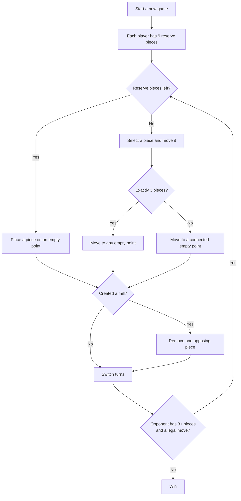
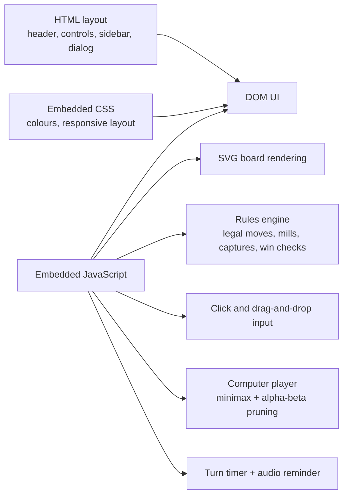

# Malom

A small, self-contained web implementation of **Malom** (Nine Men’s Morris), written in HTML, CSS, and vanilla JavaScript. It runs directly in a modern browser—there are no packages, server, or build step.

## What it does

- Plays the classic two-player Malom board game on a 24-position board.
- Supports playing against the computer or a local opponent on the same device.
- Lets players place pieces, move pieces along connected lines, and drag pieces as an alternative to clicking.
- Allows “flying” to any open position when a player has exactly three pieces left.
- Detects mills (three pieces in a row), then lets the player remove an opposing piece; pieces outside a mill are preferred where possible.
- Ends the game when a player has fewer than three pieces or has no legal move; declares a draw after 100 moves without a mill.
- Includes a 30-second turn display with a light audio reminder after time runs out.
- Offers five computer difficulty levels and adapts its layout for phones and larger screens.

> The visible game text is Hungarian: for example, `Piros` means red, `Kék` means blue, and `Új játék` means new game.

## Run it

Open [index.html](./index.html) in a current web browser. That is all that is required.

For the new creative-coding page, open [fractals.html](./fractals.html). It includes Mandelbrot and Julia sets plus a procedural terrain view, safe starting values, parameter explanations, and manual redraw controls.

## How a game proceeds



## Project structure

The current project intentionally has a compact, single-file structure:

```text
malom/
├── index.html   # Markup, styling, game board, input handling, rules, AI, and UI text
└── README.md    # This guide
```

Inside `index.html`, the responsibilities are arranged as follows:



## Computer opponent

The computer plays blue. Difficulty levels change how it chooses moves:

| Level | Behaviour |
| --- | --- |
| 1 — Beginner | Mostly random legal moves |
| 2–4 | Increasingly deep minimax search |
| 5 — Professional | Deep search with minimal randomness |

The evaluation values material advantage, potential mills, the opponent’s potential mills, and whether either player can move. The search uses alpha-beta pruning to avoid evaluating branches that cannot improve the result.

## Key rules implemented

| Situation | Behaviour |
| --- | --- |
| Placement phase | Players alternate placing their nine pieces on free points. |
| Movement phase | A piece may move only to an adjacent free point. |
| Three remaining pieces | A player may move a piece to any free point (“flying”). |
| Mill | Forming a line of three allows removal of one opponent piece. |
| Capture preference | An opponent piece not in a mill must be selected when one exists. |
| Draw | The game ends in a draw after 100 non-mill moves. |

## Pages, privacy, and calculations

The project is static: open `index.html` in a browser, then use its header links to visit `fractals.html`, `mandelbrot-zoom.html`, and `attractors.html`.

All calculations run locally in the browser. There is no backend, account, database, API call, `fetch`, WebSocket, analytics service, or remote compute service.

| Page | What happens locally |
| --- | --- |
| `index.html` | Malom rules, legal-move checks, timer, and computer opponent. |
| `fractals.html` | Fractal pixels and recursive visual experiments. |
| `mandelbrot-zoom.html` | Mandelbrot pixel recalculation for the currently selected complex-plane square. |
| `attractors.html` | Numerical time-step integration and canvas drawing for the listed attractors. |

The Malom computer generates legal moves, simulates future positions with minimax and alpha-beta pruning, and scores material, potential mills, threats, and mobility. It is local game logic, not an online service or machine-learning model.

For Mandelbrot, every pixel is a complex coordinate `c`; the page repeatedly calculates `z = z² + c` starting with `z = 0`. Dragging a square in the zoom page selects a smaller complex-plane range, which is recalculated locally. Attractors repeatedly apply their differential equations in small local time steps and draw the resulting trajectory.

The only optional external navigation is a Goodreads link that can appear after a computer win. The browser reaches Goodreads only if the user chooses to click it; no data is sent automatically.

## Python versions

This repository also contains two Python Malom implementations:

- `python_malom/` is a standard-library implementation. See [`README-python.md`](./README-python.md) for its setup and architecture.
- The repository-root `app.py`, `game_engine.py`, `ai.py`, `templates/`, and `static/` files form a Flask learning version. See [`README-FLASK.md`](./README-FLASK.md) for setup, API flow, and tests.

The browser-only version above still runs directly from `index.html` without a server.
