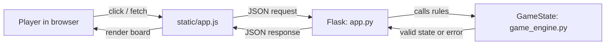
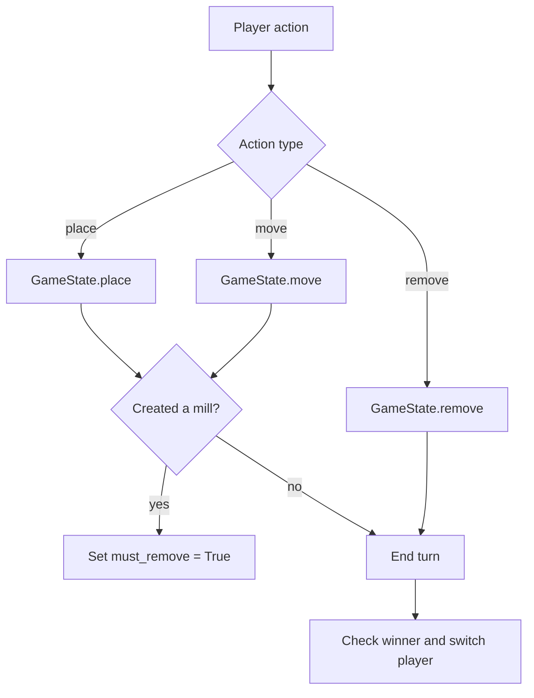
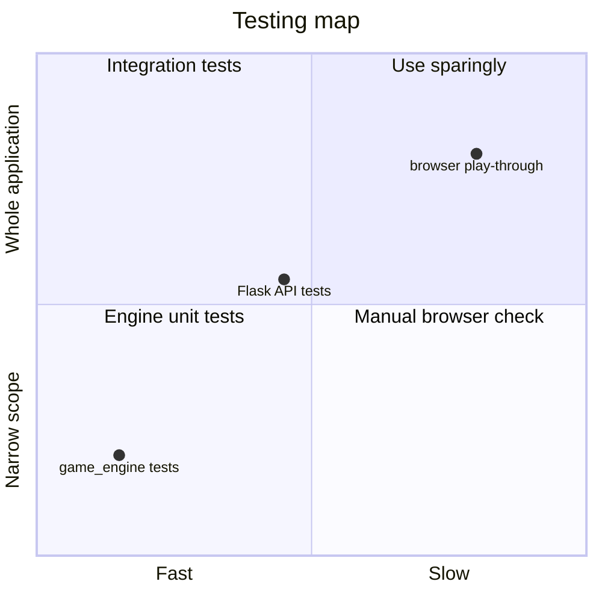
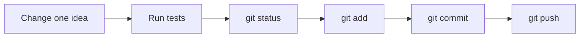

# Malom: learn Python, Git, and Codex

This project is a small **Nine Men's Morris (Malom)** web application designed for learning. The original one-file browser prototype remains in `index.html`; the Python version uses a clear backend/frontend split.

## What you will learn

| Topic | Where to look | Why it matters |
| --- | --- | --- |
| Python functions and classes | `game_engine.py` | Game rules live in named, testable functions. |
| HTTP routes and JSON | `app.py` | Flask connects a browser request to Python code. |
| Browser JavaScript | `static/app.js` | It renders data and sends player actions to the server. |
| HTML and CSS | `templates/index.html`, `static/style.css` | They provide the page structure and appearance. |
| Automated tests | `tests/test_game_engine.py` | Tests protect rules while you make changes. |
| Git | the workflow below | Git saves meaningful checkpoints of your work. |

## Architecture



The important boundary is between `app.py` and `game_engine.py`: Flask knows about web requests; the engine knows about Malom rules. That means the rules can be tested without a browser or a server.



## Request flow, step by step

1. You click a board position.
2. `static/app.js` sends a small JSON message, for example `{"kind":"place","destination":0}`.
3. The `/api/action` function in `app.py` reads that message.
4. It calls `game.place(0)` in `game_engine.py`.
5. The engine either updates the state or raises `InvalidMove`.
6. Flask returns JSON and JavaScript redraws the page.

## Run it locally

You need **Python 3.10+** and one external Python package: [Flask](https://flask.palletsprojects.com/). Flask is a small local web server used only to deliver the page and API; no external server, plugin, database, or API key is used.

```powershell
py -m venv .venv
.\.venv\Scripts\Activate.ps1
py -m pip install -r requirements.txt
py app.py
```

Open the local address printed by Flask, usually `http://127.0.0.1:5000`.

If PowerShell blocks activation, run this for the current terminal only, then repeat the activation command:

```powershell
Set-ExecutionPolicy -Scope Process -ExecutionPolicy Bypass
```

## Run the tests

```powershell
py -m unittest discover -s tests
```

The test chart below shows the useful testing layers for this project.



## A first Git workflow

After GitHub can resolve its network connection, make your first repository checkpoint:

```powershell
git status
git add app.py game_engine.py templates static tests README.md requirements.txt .gitignore
git commit -m "Add Python Malom learning app"
git push -u origin main
```

For future changes, use this loop:



Before committing, `git status` tells you exactly what will be saved. A commit message should describe the change, not simply say “update”.

## Good next exercises

1. Add a **draw after 100 moves** rule in `GameState`.
2. Add a Flask route test for `/api/action`.
3. Save games to a JSON file, then compare that with a database later.
4. Add a computer opponent — create a new `ai.py` module so game rules stay clean.
